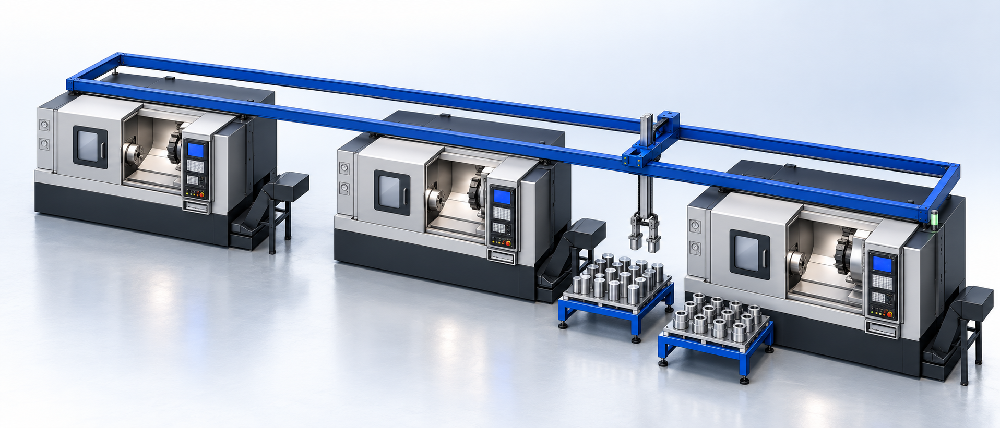
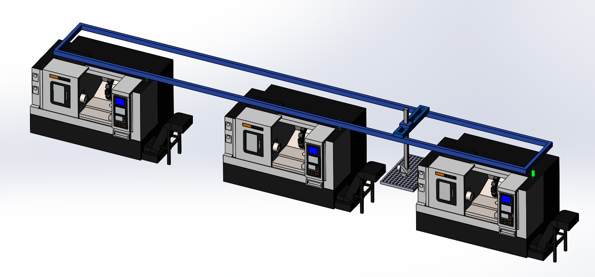
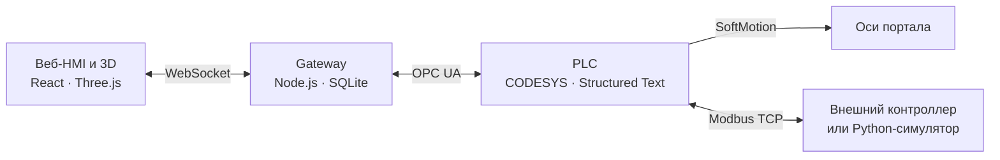

<div align="center">

# Portal Robot

**Управление портальной роботизированной ячейкой**

PLC-логика · Веб-HMI · 3D-визуализация · Симуляция

[Документация](DOKS/README.md) · [Архитектура](DOKS/05-architecture.md) · [Тесты и покрытие](DOKS/31-test-coverage-and-acceptance.md)

</div>



<sub>Обложка — сгенерированная иллюстрация по CAD-компоновке проекта.</sub>

Portal Robot управляет подачей заготовок, обслуживанием станков и возвратом готовых деталей. PLC выполняет технологическую логику и проверяет разрешения команд; браузер показывает состояние ячейки и даёт оператору управление.

## Состав ячейки

| Оборудование | Конфигурация |
| --- | --- |
| Портальный робот | Оси X/Y/Z, два захвата |
| Станки | Три станка с ЧПУ |
| Магазины | Два статичных по 120 мест либо два механизма с двумя палетами по 96 мест |
| Геометрический контроль | Две независимые станции с конвейерами |



## Возможности

- Автоматическое обслуживание станков, работа с несколькими типами деталей и смена палет.
- 3D-сцена, ручное управление, JOG и редактор точек робота.
- Аварии, предупреждения, диагностика I/O и контроллера, журнал событий с действиями оператора.
- Учёт выпуска, загрузки оборудования и циклограмма работы.
- Приёмочные сценарии, проверки аварий и восстановления, локальные тесты ST-логики и Python-симулятор Modbus TCP.

## Как устроено



Интерфейс управления движением выбирается в конфигурации: **SoftMotion или Modbus TCP**. Веб-интерфейс получает данные и передаёт команды через gateway.

## Быстрый запуск HMI

Нужны Node.js с поддержкой `node:sqlite` и работающий PLC Runtime с опубликованной группой `GVL_HMI`.

```powershell
cd visu
npm ci
$env:OPCUA_ENDPOINT = 'opc.tcp://127.0.0.1:4840'
npm run dev:live
```

HMI: **http://127.0.0.1:5173**. Для отдельного контроллера укажи его адрес в `OPCUA_ENDPOINT`.

Подробности: [запуск и адреса](DOKS/04-run-and-ip.md), [настройка OPC UA](DOKS/02-opc-ua.md), [Python-симулятор](robot_simulator/README.md).

## Проверки

После установки зависимостей HMI и [Python-окружения симулятора](robot_simulator/README.md) все локальные проверки запускаются из корня:

```powershell
.\verify.cmd
```

Команда проверяет Python, Node.js-контракты, инструменты проекта и сборку HMI без подключения к PLC. Проверки работающего Runtime запускаются отдельно в HMI: **«Сценарии и тесты → Приёмка»**. Условия запуска и границы покрытия описаны в [аудите тестов](DOKS/31-test-coverage-and-acceptance.md).

## Где что лежит

| Путь | Содержимое |
| --- | --- |
| [`Portal_robot/Device/application`](Portal_robot/Device/application) | PLC-исходники на Structured Text |
| [`visu/src`](visu/src) | React HMI и Three.js-сцена |
| [`visu/gateway`](visu/gateway) | OPC UA, команды, журналы и хранение данных |
| [`robot_simulator`](robot_simulator) | Симулятор, модели ST и тестовые сценарии |
| [`DOKS`](DOKS/README.md) | Архитектура, контракты и эксплуатационные инструкции |

Проект находится в разработке. Компиляция в CODESYS и проверка на оборудовании выполняются отдельно от локальных тестов.
